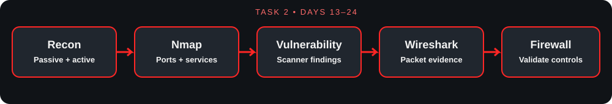
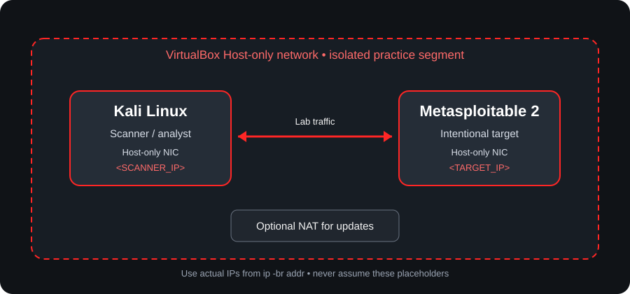
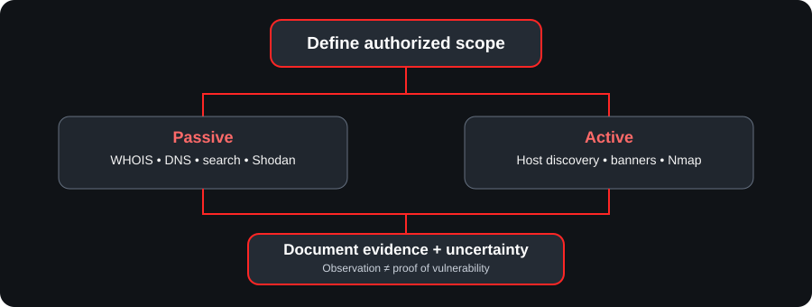
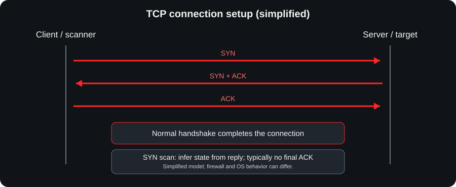
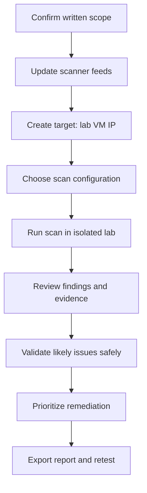
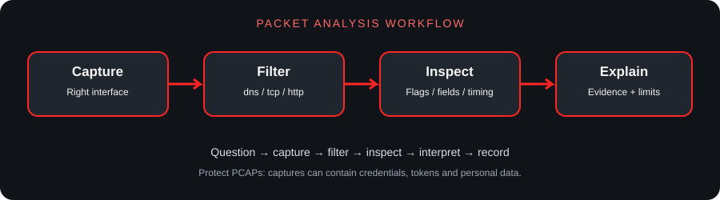
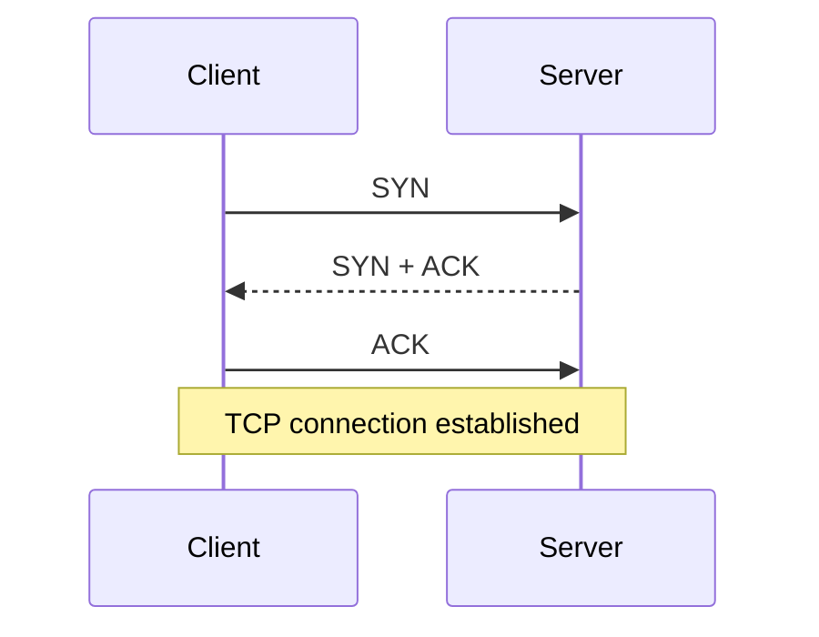
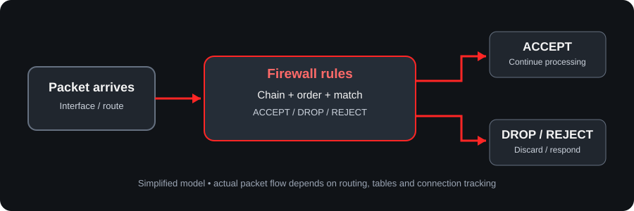

# ApexPlanet Cybersecurity Internship --- Task 2

## Network Security & Scanning

**Personal study notes · RootVector · Days 13--24**



*Reconnaissance → scanning → vulnerability assessment → packet analysis
→ firewall validation*
:::

> **Lab boundary:** These notes are for my isolated VirtualBox practice
> environment, especially my own Kali Linux attacker VM and
> intentionally vulnerable Metasploitable 2 / DVWA targets. I will only
> scan systems I own or have explicit written permission to test. Public
> search engines and Shodan are for research; finding a system online is
> not permission to test it.

------------------------------------------------------------------------

## Contents

-   [1. Task brief and goals](#1-task-brief-and-goals)
-   [2. My lab scope and safety rules](#2-my-lab-scope-and-safety-rules)
-   [3. Network security vocabulary](#3-network-security-vocabulary)
-   [4. Reconnaissance](#4-reconnaissance)
    -   [Passive reconnaissance](#passive-reconnaissance)
    -   [Active reconnaissance](#active-reconnaissance)
-   [5. Nmap: host, port, service and OS
    discovery](#5-nmap-host-port-service-and-os-discovery)
-   [6. Vulnerability scanning with Greenbone/OpenVAS or Nessus
    Essentials](#6-vulnerability-scanning-with-greenboneopenvas-or-nessus-essentials)
-   [7. Wireshark packet analysis](#7-wireshark-packet-analysis)
-   [8. TCP, UDP, DNS, HTTP and FTP
    observations](#8-tcp-udp-dns-http-and-ftp-observations)
-   [9. SYN flood concept and safe lab
    observation](#9-syn-flood-concept-and-safe-lab-observation)
-   [10. Firewall basics with
    iptables](#10-firewall-basics-with-iptables)
-   [11. Reporting template](#11-reporting-template)
-   [12. Task 2 checklist](#12-task-2-checklist)
-   [13. Troubleshooting notes](#13-troubleshooting-notes)
-   [14. Quick command reference](#14-quick-command-reference)
-   [15. References](#15-references)

------------------------------------------------------------------------

## 1. Task brief and goals

### What the internship guide asks for

The ApexPlanet guide labels this **Task 2 --- Network Security &
Scanning**, scheduled for **Days 13--24**. Its objective is to learn
reconnaissance, scanning and network traffic analysis.

The listed work is:

1.  **Reconnaissance**
    -   Passive: WHOIS, `nslookup`, Google dorking and Shodan.
    -   Active: ping sweep and banner grabbing.
2.  **Port and service scanning**
    -   Nmap TCP and UDP scans (`-sS`, `-sU`).
    -   Service-version detection (`-sV`) and OS detection (`-O`).
    -   Write a scan report for test systems.
3.  **Vulnerability scanning**
    -   Set up OpenVAS/Greenbone or Nessus Essentials.
    -   Scan the Metasploitable 2 test VM.
    -   Review Critical / High / Medium / Low findings.
4.  **Packet analysis**
    -   Capture HTTP, FTP and DNS traffic.
    -   Understand why credentials in unencrypted FTP can be exposed.
    -   Observe the network effects of a SYN-flood simulation using
        `hping3`.
5.  **Firewall basics**
    -   Write simple `iptables` rules to allow or deny selected ports.
    -   Demonstrate how filtering changes the result of a scan.

### Deliverables from the guide

-   Nmap scan report and vulnerability scan report.
-   GitHub repository with detailed scan analysis.
-   A five-minute demo video showing a scan and its findings.

**My learning target:** not just to collect tool output, but to explain
what each observation means, what it does *not* prove, and what a system
owner should do next.

------------------------------------------------------------------------

## 2. My lab scope and safety rules

### Lab topology

The diagram below is a conceptual layout. I must replace example
addresses with the addresses actually assigned to my VMs; never assume
the sample addresses are correct for a new boot.



A typical VirtualBox practice setup can use:

-   **Kali Linux** --- analysis / scanner VM.
-   **Metasploitable 2** --- intentionally vulnerable target VM.
-   **DVWA** --- intentionally vulnerable web application, if used.
-   **Host-only network** --- private communication between VMs.
-   **NAT adapter** --- optional internet access for updates. Keep this
    separate from the target-facing lab interface where possible.

### Record the real addresses first

``` bash
ip -br addr
ip route
ip neigh
```

On the target VM, use its available local commands to identify its
address. Confirm the two VMs can communicate before scanning:

``` bash
ping -c 4 <TARGET_IP>
```

If ping fails, that alone does not prove the target is offline: ICMP may
be filtered, the interface may be down, or the VMs may be on different
virtual networks.

### Scope record

Before running tools, fill in this block in my lab log:

  -----------------------------------------------------------------------
  Item                                My value
  ----------------------------------- -----------------------------------
  Date / time                         `Sun Oct 25 12:44:50 AM EDT 2026`

  Scanner VM                          Kali Linux

  Target VM                           Metasploitable 2 / DVWA

  Scanner interface                   `eth0`

  Scanner IP                          `192.168.56.4`

  Target IP                           `192.168.56.3`

  VirtualBox network mode             Host-only / isolated lab

  Approved target range               `<TARGET_IP>/32` or my explicitly
                                      approved lab subnet

  Test purpose                        Inventory, exposure review, packet
                                      analysis

  Evidence folder                     `evidence/`
  -----------------------------------------------------------------------

### Safe operating rules

-   Use a single target IP (`192.168.56.3`) when learning; widen the
    range only when I know it is my isolated subnet.
-   Do not scan public IPs, campus networks, hostel networks or other
    people's devices without explicit authorization.
-   Do not run flood modes or high-rate packet tests against public
    systems.
-   Keep screenshots, logs and PCAPs free of real passwords, tokens,
    personal data and unrelated traffic.
-   Store test credentials only if needed for a controlled
    demonstration; do not publish them in the GitHub repository.
-   If a scan creates unexpected load or affects a system, stop the test
    and investigate.

------------------------------------------------------------------------

## 3. Network security vocabulary

  -----------------------------------------------------------------------
  Term                                My notes
  ----------------------------------- -----------------------------------
  **Asset**                           A system, service, application or
                                      data that needs protection.

  **Attack surface**                  The set of interfaces and services
                                      that could be reached or misused.

  **Reconnaissance**                  Gathering information to understand
                                      a target or environment before
                                      testing.

  **Port**                            A transport-layer endpoint number
                                      associated with a service on a
                                      host.

  **Open port**                       A service is accepting connections
                                      or responding in a way consistent
                                      with a listening service.

  **Closed port**                     The host is reachable, but no
                                      service is listening on that port
                                      (the exact response depends on
                                      protocol and firewall).

  **Filtered**                        Nmap cannot determine whether the
                                      port is open because filtering or
                                      another network condition prevents
                                      a clear response.

  **Service fingerprint**             Clues from a protocol response,
                                      banner or probe that help identify
                                      the service and sometimes its
                                      version.

  **Vulnerability**                   A weakness that could affect
                                      confidentiality, integrity or
                                      availability under certain
                                      conditions.

  **False positive**                  A reported issue that is not
                                      actually present or does not apply
                                      in the way the scanner claims.

  **False negative**                  A real issue that the scan fails to
                                      detect.

  **PCAP**                            A packet-capture file that can be
                                      opened by tools such as Wireshark.

  **Least privilege**                 Give an account or process only the
                                      access it needs.

  **Defense in depth**                Use multiple complementary controls
                                      instead of relying on one control
                                      alone.
  -----------------------------------------------------------------------

### Important distinction: discovery is not proof of compromise

A port scan identifies observable network behavior. A service-version
guess is not always exact. A vulnerability scanner produces findings
that need validation. A report should distinguish **observed evidence**,
**tool inference**, **risk interpretation** and **confirmed impact**.

------------------------------------------------------------------------

## 4. Reconnaissance

Reconnaissance helps answer: *What is already publicly visible, and what
can I observe from my authorized lab?*



### Passive reconnaissance

Passive recon uses existing public information or third-party indexes.
It generally avoids sending probes directly to the target, although the
service being used (for example, a DNS resolver) still receives a query.

#### 4.1 WHOIS

**Purpose:** inspect registration information associated with a domain
or IP allocation. Available fields vary by registrar, registry, privacy
service and regional policy.

``` bash
whois example.com
```

Use `example.com` only as a documentation example. For a real
organization, stay within the agreed scope.

**What I look for** - Registrar and relevant registration dates, when
published. - Authoritative name servers. - Organization / registrant
fields, if not redacted. - Whether the output refers to a domain
registration or an IP network allocation.

**Limits:** WHOIS does not reveal every host, prove ownership of a
particular server, or establish that a system is vulnerable. Data may be
redacted or stale.

#### 4.2 `nslookup` and DNS records

``` bash
nslookup example.com
nslookup -type=A example.com
nslookup -type=AAAA example.com
nslookup -type=MX example.com
nslookup -type=NS example.com
nslookup -type=TXT example.com
```

-   **A** --- IPv4 address.
-   **AAAA** --- IPv6 address.
-   **MX** --- mail exchanger records.
-   **NS** --- authoritative name-server records.
-   **TXT** --- arbitrary text records, often used for verification and
    email security policy.

A DNS answer is a time-specific result from the resolver queried.
Caching, split-horizon DNS, load balancing, CDN front ends and DNS
changes can make results differ across networks.

#### 4.3 Google search operators ("Google dorking")

Search operators can narrow public search results. They are not magic
access mechanisms and do not bypass authorization.

Examples using a documentation domain:

``` text
site:example.com
site:example.com filetype:pdf
site:example.com intitle:"index of"
site:example.com inurl:login
```

**How I use this responsibly** 1. Search only for public information
relevant to an approved assessment. 2. Do not attempt to log in to
discovered portals or download exposed sensitive data. 3. If I find what
appears to be sensitive information, record the minimum evidence needed
and report it through an authorized channel. 4. Do not assume a search
result is current; open the source and verify context.

#### 4.4 Shodan

Shodan indexes service banners observed by its crawlers. Its help
documentation describes queries and filters such as `country:`, `port:`
and `org:`.

Example query syntax to learn with---not a target to attack:

``` text
port:443 country:IN
```

A query result can indicate an observed service and banner, but it may
be stale, incomplete or incorrectly attributed. **Do not use Shodan
results as permission to probe the listed IP.**

### Active reconnaissance

Active recon sends traffic to the system being examined. It requires
clear authorization and a known target scope.

#### 4.5 Ping sweep / host discovery

First identify the approved lab subnet. Then, if the entire subnet
belongs to the isolated lab, a discovery scan can be used:

``` bash
nmap -sn <LAB_SUBNET_CIDR>
```

For a single known lab target:

``` bash
nmap -sn <TARGET_IP>
```

`-sn` requests host discovery without a port scan. Results depend on
which probes are allowed and how the target responds. On a local
Ethernet network, Nmap may use ARP discovery; across routed networks,
discovery behavior differs.

#### 4.6 Banner grabbing

A banner can expose protocol details or service metadata. In the lab,
use it to compare what a service advertises with what Nmap reports.

``` bash
nc -nv <TARGET_IP> <PORT>
```

Use only on a port I have identified on my own lab target. Some
protocols expect a specific first message, so a blank response is not
proof that the port is empty or broken.

For a web service, I can request headers from my own lab service:

``` bash
curl -I http://<TARGET_IP>/
```

**Record:** target, port, time, command, raw response, inferred service,
confidence and follow-up needed.

------------------------------------------------------------------------

## 5. Nmap: host, port, service and OS discovery

Nmap helps identify live hosts, exposed TCP/UDP ports, likely services
and sometimes operating-system fingerprints. I should read the official
Nmap Reference Guide rather than memorize switches without understanding
their effects.

### 5.1 Confirm the target and Nmap version

``` bash
nmap --version
ip -br addr
ip route
```

### 5.2 A careful scanning sequence

Start small and expand only if necessary:

``` bash
# 1. Host discovery against one lab target
nmap -sn <TARGET_IP>

# 2. Common TCP ports
nmap <TARGET_IP>

# 3. TCP SYN scan (usually requires elevated privileges)
sudo nmap -sS <TARGET_IP>

# 4. Service/version detection
sudo nmap -sV <TARGET_IP>

# 5. OS detection (best effort; needs suitable responses and privileges)
sudo nmap -O <TARGET_IP>

# 6. UDP scan; slower and often ambiguous
sudo nmap -sU --top-ports 20 <TARGET_IP>
```

These commands are intentionally scoped to a **single lab target**. Use
a larger port range only when required for the exercise and permitted by
the lab owner.

### 5.3 What the switches mean

  -----------------------------------------------------------------------
  Switch                  Meaning                 Caution
  ----------------------- ----------------------- -----------------------
  `-sn`                   Host discovery, no port A host may be up but
                          scan                    fail discovery probes.

  `-sS`                   TCP SYN scan            Often called a
                                                  half-open scan; needs
                                                  privileges on many
                                                  systems. It still sends
                                                  network traffic and may
                                                  be logged.

  `-sU`                   UDP port scan           UDP often has no
                                                  response;
                                                  "open\|filtered" can be
                                                  inconclusive.

  `-sV`                   Probe services to       Adds probes and may
                          estimate                take longer;
                          product/version         fingerprints are not
                                                  guaranteed.

  `-O`                    OS fingerprinting       Best effort; accuracy
                                                  depends on network
                                                  responses and
                                                  fingerprint quality.

  `-p`                    Specify ports,          Use a port list
                          e.g. `-p 22,80,443`     appropriate to the
                                                  exercise.

  `-oN`                   Save normal output to a Keep the report with
                          file                    the date and scope.

  `-oA`                   Save output in multiple Useful for retaining
                          formats with a common   text, XML and grepable
                          basename                output.

  `-Pn`                   Skip host discovery and Can make scans slower;
                          treat target as up      use only when discovery
                                                  is known to be blocked.

  `-T`                    Adjust timing template  Faster timing can
                                                  increase traffic and
                                                  reduce reliability;
                                                  default is a sensible
                                                  starting point.
  -----------------------------------------------------------------------

### 5.4 Understanding common port states

-   **open:** the target accepted or responded in a way that indicates a
    service is listening.
-   **closed:** the target responded, but no application is listening on
    that port.
-   **filtered:** a firewall or network condition prevented Nmap from
    determining open/closed.
-   **open\|filtered:** Nmap cannot distinguish an open UDP port from
    one that is filtered.
-   **closed\|filtered:** used by certain scan types when the
    distinction cannot be determined.

Port state is an observation from a specific vantage point and
time---not a permanent property of the host.

### 5.5 Save evidence reproducibly

``` bash
mkdir -p evidence/task-2/nmap
sudo nmap -sS -sV -O <TARGET_IP> \
  -oA evidence/nmap/target-initial
```

If I want a separate UDP result:

``` bash
sudo nmap -sU --top-ports 20 <TARGET_IP> \
  -oA evidence/task-2/nmap/target-udp-top20
```

Record the exact command, Nmap version, scanner IP, target IP, date/time
and any limitations. Avoid naming a report "full scan" unless the actual
port scope justifies that label.

### 5.6 Scan interpretation worksheet

  ---------------------------------------------------------------------------------------------------------------------------------
  Port /         State       Service guess Version evidence     Why it matters                    Next step
  protocol                                                                                        
  -------------- ----------- ------------- -------------------- --------------------------------- ---------------------------------
  `<port>/tcp`   `<state>`   `<service>`   `<banner/version>`   `<exposure or business impact>`   `<verify / restrict / patch>`

  `<port>/udp`   `<state>`   `<service>`   `<evidence>`         `<impact>`                        `<confirm with safe follow-up>`
  ---------------------------------------------------------------------------------------------------------------------------------

### 5.7 TCP SYN scan --- concept diagram



A normal TCP connection generally completes SYN → SYN/ACK → ACK. A SYN
scan infers port state from replies to a SYN probe and typically does
not complete the normal connection for an open port. This is a
simplified conceptual model; actual results depend on operating system,
firewall behavior and packet loss.

------------------------------------------------------------------------

## 6. Vulnerability scanning with Greenbone/OpenVAS or Nessus Essentials

A vulnerability scanner checks a target against a collection of tests
and known issue signatures. It can help prioritize investigation, but
its output is not automatically a confirmed exploit or a complete
security assessment.

### 6.1 Pick one scanner

The internship guide allows either:

-   **Greenbone Community Edition / OpenVAS** --- open-source
    vulnerability-management stack.
-   **Nessus Essentials** --- another scanner option; follow the current
    vendor licensing and installation requirements.

I should choose the one that fits my VM resources and the internship
requirements instead of installing multiple heavy scanners at once.

### 6.2 High-level workflow



### 6.3 Before scanning

-   Confirm the target IP from the VM itself.
-   Check the scanner can reach the target.
-   Ensure the VM has sufficient RAM, disk and CPU.
-   Allow the scanner feeds to synchronize; first-time setup can take a
    while.
-   Use a scan profile suitable for a lab target.
-   Avoid aggressive tests against any non-lab system.

### 6.4 Severity is prioritization---not the whole risk story

  -----------------------------------------------------------------------
  Severity label                      How I interpret it
  ----------------------------------- -----------------------------------
  **Critical**                        Potentially severe impact;
                                      investigate promptly and validate
                                      exposure.

  **High**                            Significant potential impact;
                                      prioritize confirmation and
                                      remediation.

  **Medium**                          Meaningful risk that depends on
                                      reachability, configuration and
                                      context.

  **Low**                             Lower-severity issue or hardening
                                      recommendation; still document it.

  **Log / Info**                      Informational evidence or
                                      observation; not necessarily a
                                      vulnerability.
  -----------------------------------------------------------------------

The scanner's label is one input. Actual risk also depends on exposure,
exploitability, privileges required, data sensitivity, compensating
controls and business impact.

### 6.5 Finding review template

For each meaningful finding, write:

-   **Finding title and scanner ID:**
-   **Severity / CVSS (if provided):**
-   **Affected host and port:**
-   **Evidence quoted from the report:**
-   **Scanner's rationale:**
-   **Is the service reachable from the relevant network?**
-   **Validation performed (if any):**
-   **Confidence:** confirmed / likely / unconfirmed / false positive
-   **Potential impact:**
-   **Recommended fix:**
-   **Retest result:**
-   **Evidence filename:**

Do not copy a scanner report without interpreting it. Remove any
credentials, sensitive host details or unrelated data before publishing.

------------------------------------------------------------------------

## 7. Wireshark packet analysis

Wireshark captures packets visible to the selected network interface and
decodes many protocols. It does not automatically see all traffic on a
switched network; capture location and interface matter.



### 7.1 Capture a small, understandable sample

1.  Start Wireshark on the correct Kali interface.
2.  Confirm the interface has traffic.
3.  Begin a capture.
4.  Generate a small, known action inside the lab---for example, ping
    the target or load the target's DVWA page.
5.  Stop the capture after enough packets have been collected.
6.  Save as `evidence/task-2/pcap/lab-traffic.pcapng`.
7.  Apply display filters to answer one question at a time.

### 7.2 Capture filter vs display filter

These are different filter languages:

-   **Capture filter:** applied before/during capture; limits which
    packets are saved. Example: `host 192.168.56.104`
-   **Display filter:** applied after packets have been captured; hides
    packets that do not match. Example: `ip.addr == 192.168.56.104`

Replace the sample IP with the target IP in my lab.

### 7.3 Useful display filters

  --------------------------------------------------------------------------------
  Goal                                Display filter
  ----------------------------------- --------------------------------------------
  Show DNS                            `dns`

  Show HTTP                           `http`

  Show FTP control traffic            `ftp`

  Show TCP                            `tcp`

  Show UDP                            `udp`

  Show ICMP / ping                    `icmp`

  Show packets involving the lab      `ip.addr == <TARGET_IP>`
  target                              

  Show traffic from the target        `ip.src == <TARGET_IP>`

  Show traffic to the target          `ip.dst == <TARGET_IP>`

  Show TCP SYN packets                `tcp.flags.syn == 1`

  Show SYN packets without ACK        `tcp.flags.syn == 1 && tcp.flags.ack == 0`

  Show TCP resets                     `tcp.flags.reset == 1`

  Show packets to TCP port 80         `tcp.dstport == 80`

  Show DNS queries by name (if        `dns.qry.name`
  decoded)                            
  --------------------------------------------------------------------------------

The filter syntax depends on protocol fields available in the capture.
If a filter is red or rejected, check spelling and the installed
Wireshark version's display-filter reference.

### 7.4 A repeatable observation method

For each capture, write:

1.  **Question:** What am I trying to find?
2.  **Setup:** Which interface and which lab action produced the
    traffic?
3.  **Filter:** What display filter did I use?
4.  **Observation:** Which packets, addresses, ports, flags or names did
    I see?
5.  **Interpretation:** What is the most reasonable explanation?
6.  **Limitation:** What cannot be concluded from this capture alone?
7.  **Evidence:** PCAP filename and screenshot filename.

### 7.5 Example: DNS request

A DNS lookup often involves a client sending a query to a resolver and
receiving a response. In Wireshark, inspect the query name, query type,
response code and answer records. DNS can use UDP or TCP; encrypted DNS
protocols may not be decoded as ordinary DNS in the capture.

### 7.6 Example: HTTP vs HTTPS

Ordinary HTTP does not provide transport encryption, so some application
data may be readable in a packet capture. HTTPS uses TLS to protect
application content in transit, although metadata such as IP addresses,
ports, packet sizes and timing can remain visible. The exact metadata
visible depends on protocol versions and configuration.

------------------------------------------------------------------------

## 8. TCP, UDP, DNS, HTTP and FTP observations

### 8.1 TCP and UDP comparison

  -----------------------------------------------------------------------
  Property                TCP                     UDP
  ----------------------- ----------------------- -----------------------
  Connection model        Connection-oriented     Connectionless
                                                  datagrams

  Delivery                Sequence numbers,       No built-in guarantee
                          acknowledgements and    of delivery, ordering
                          retransmission support  or retransmission
                          reliable byte-stream    
                          delivery                

  Common uses             HTTP/HTTPS transport,   DNS in many cases,
                          SSH, many mail          streaming/real-time
                          protocols               traffic, DHCP

  Scan interpretation     SYN/ACK, RST and        Silence is ambiguous;
                          filtering behavior can  open ports may not
                          reveal state            respond to generic
                                                  probes

  Packet clues            SYN, SYN/ACK, ACK, FIN, UDP header and
                          RST                     application protocol
                                                  response
  -----------------------------------------------------------------------

### 8.2 TCP connection outline



### 8.3 DNS observation checklist

-   Which system sent the query?
-   What resolver received it?
-   What was the query name and type?
-   Was there a response?
-   What response code was returned?
-   Did the answer contain an address, alias or mail server record?
-   Was the query retransmitted?
-   Is this a normal lookup, or could it be a timeout, cache miss or
    blocked request?

### 8.4 HTTP observation checklist

-   Method (GET, POST, etc.), if visible.
-   Host / path / status code, if visible.
-   Request and response headers.
-   Server response timing.
-   Whether the traffic is plain HTTP or protected by TLS.
-   Whether any sensitive value is exposed in the lab capture.

Do not upload real session cookies, bearer tokens or passwords to a
public repository.

### 8.5 FTP and plaintext credentials

Traditional FTP commonly uses a separate control connection and can
transmit commands and authentication information without encryption. If
the lab deliberately uses unencrypted FTP, a packet capture may reveal
test login details.

**Safe demonstration** 1. Use only the Metasploitable 2 VM or another
intentionally vulnerable lab target. 2. Use a disposable test account
and a fake password. 3. Start Wireshark on the interface that sees the
lab traffic. 4. Connect from a lab client to the target's FTP service.
5. Apply `ftp` or a suitable TCP-port filter. 6. Inspect decoded control
messages and note whether authentication data is readable. 7. Stop and
remove or protect the capture; never publish the test password. 8.
Recommend SFTP or FTPS, depending on the service requirement, rather
than traditional unencrypted FTP.

**Security lesson:** encryption protects credentials and content in
transit. The right fix is to use a secure protocol, restrict network
access and avoid reusing credentials---not merely to hide the packets
from Wireshark.

------------------------------------------------------------------------

## 9. SYN flood concept and safe lab observation

A SYN flood is a denial-of-service technique that sends many TCP
connection-initiation packets and can consume resources associated with
half-open connections. It can degrade availability. **Do not run a flood
against public systems or any network you do not control.**

The internship guide mentions `hping3` for analyzing a SYN-flood attack.
For this task, I should prioritize understanding the packet pattern and
defensive telemetry. Do not use `--flood` mode; high-rate traffic is
unnecessary for a learning capture.

### What the packet pattern means


A SYN packet by itself is not evidence of an attack. Browsers, scanners
and ordinary clients send SYN packets. A SYN-flood suspicion requires
context such as unusually high rates, many incomplete handshakes,
resource pressure and a lack of corresponding completed sessions.

### Safer lab exercise

-   Capture normal TCP connection setup to a service on the isolated
    target.
-   Filter `tcp.flags.syn == 1 && tcp.flags.ack == 0`.
-   Compare the SYN packets with SYN/ACK and ACK responses.
-   Review target-side connection state and logs if available.
-   Record packet count and time window.
-   Explain what additional evidence would be needed before calling the
    activity a SYN flood.

If a controlled instructor-approved simulation is specifically required,
follow the lab's rate limits and stop conditions. Keep the target
isolated, use a fixed low packet count and stop immediately if the VM
becomes unstable. This README intentionally does not provide an
unbounded flood command.

### Mitigation concepts

-   SYN cookies or appropriate TCP-stack protections.
-   Rate limiting and upstream DDoS protections where appropriate.
-   Capacity planning and monitoring of half-open connections.
-   Firewall / load balancer policies appropriate to the service.
-   Alerting on abnormal connection rates while accounting for
    legitimate bursts.

A firewall rule alone is not a universal DDoS solution, especially if
the traffic saturates the link before reaching the host.

------------------------------------------------------------------------

## 10. Firewall basics with iptables

A host firewall controls traffic according to rules. `iptables` is a
command-line interface for netfilter; on many current Linux
distributions, the underlying implementation may use the `iptables-nft`
compatibility layer. Check the local system rather than assuming every
distribution behaves identically.

### 10.1 Inspect before changing rules

``` bash
sudo iptables -S
sudo iptables -L -n -v
sudo iptables -t nat -S
```

Before experimenting: - Confirm whether the rules apply to the scanner
or target VM. - Keep VirtualBox console access available so a bad rule
does not lock me out. - Save or document the current rules. - Never
apply experimental firewall rules to a remote machine where I could lose
access.

### 10.2 Rule-chain mental model



-   **INPUT** --- traffic destined for this host.
-   **OUTPUT** --- traffic generated by this host.
-   **FORWARD** --- traffic routed through this host.
-   **PREROUTING / POSTROUTING** --- packet processing around routing,
    often relevant to NAT.

Rules are evaluated in order within a chain; the first matching
terminating verdict may decide what happens. Exact behavior also depends
on connection tracking, tables, policies and other firewall frameworks.

### 10.3 Example: allow loopback and established traffic, then deny one lab service

**Only run these on a disposable lab VM, after confirming which VM you
are modifying.** This example changes the host's INPUT chain and can
disrupt access if applied to the wrong machine.

``` bash
# Inspect the current rules first.
sudo iptables -S

# Allow loopback traffic.
sudo iptables -A INPUT -i lo -j ACCEPT

# Allow packets associated with existing/related connections.
sudo iptables -A INPUT -m conntrack \
  --ctstate ESTABLISHED,RELATED -j ACCEPT

# Example: deny new TCP connections to port 21 on this lab host.
sudo iptables -A INPUT -p tcp --dport 21 \
  -m conntrack --ctstate NEW -j DROP

# Inspect counters and rule order.
sudo iptables -L INPUT -n -v --line-numbers
```

This is an **illustrative rule set, not a complete host firewall
policy**. It does not define a full default-deny policy, may leave other
ports accessible, and the effect depends on existing rules and chain
order. Do not blindly flush rules or set a default DROP policy on a
system you depend on.

### 10.4 Validate the change

1.  Record a baseline scan of the authorized lab target.
2.  Apply one firewall rule.
3.  Scan only the target VM and the specific port relevant to that rule.
4.  Inspect firewall counters with `iptables -L -n -v`.
5.  Compare before/after results.
6.  Remove the test rule when finished, using the exact rule or its line
    number after rechecking the current list.

For example, after confirming the rule is the last matching test rule:

``` bash
sudo iptables -L INPUT -n -v --line-numbers
```

If removing by line number, the number may change as rules are edited;
always inspect the chain immediately before deleting. Document the exact
change and its result.

### 10.5 Firewall test log

  --------------------------------------------------------------------------------------------
  Time           Change made                   Scan / test     Observed       Interpretation
                                                               result         
  -------------- ----------------------------- --------------- -------------- ----------------
  Before         No test rule added            `<command>`     `<result>`     Baseline

  After          `<exact rule>`                `<same test>`   `<result>`     Did filtering
                                                                              change the
                                                                              observable
                                                                              state?

  Cleanup        `<rule removed / restored>`   Recheck rules   `<result>`     Lab returned to
                                                                              expected state
  --------------------------------------------------------------------------------------------

------------------------------------------------------------------------

## 11. Reporting template

Use this structure for the GitHub scan analysis. Fill in actual results
from the lab; **do not fabricate open ports, vulnerabilities, packet
counts or screenshots**.

``` markdown
# Network Security & Scanning Report

## 1. Summary
- Assessment date:
- Authorized scope:
- Scanner VM / IP:
- Target VM / IP:
- Main observations:
- Important limitations:

## 2. Method
- Reconnaissance performed:
- Nmap version and exact commands:
- Vulnerability scanner and feed date:
- Wireshark interface and filters:
- Firewall rule tested:

## 3. Findings
For each finding:
- Title:
- Severity:
- Evidence:
- Affected host / service:
- Potential impact:
- Confidence / validation:
- Recommended remediation:
- Retest status:

## 4. Evidence
- Nmap output:
- Vulnerability report:
- PCAP and screenshots:
- Firewall before/after output:

## 5. Limitations
- What could not be tested:
- Potential false positives / negatives:
- Visibility and network limitations:

## 6. Conclusion and remediation priorities
1.
2.
3.
```

### Evidence naming convention

``` text
evidence/
└── task-2/
    ├── nmap/
    │   ├── target-initial.nmap
    │   ├── target-initial.xml
    │   └── target-udp-top20.nmap
    ├── vulnerability-scan/
    │   └── sanitized-report.pdf
    ├── pcap/
    │   └── lab-traffic.pcapng
    ├── screenshots/
    │   ├── nmap-results.png
    │   ├── wireshark-dns.png
    │   └── firewall-before-after.png
    └── report.md
```

Keep only sanitized evidence in a public GitHub repository. Do not
commit large PCAPs or reports containing credentials, tokens or
sensitive host data. If evidence should remain private, store it outside
the public repository and describe it without exposing secrets.

------------------------------------------------------------------------

## 12. Task 2 checklist

### Reconnaissance

-   [ ] Read WHOIS output and explain its limits.
-   [ ] Query A / AAAA / MX / NS / TXT records with `nslookup`.
-   [ ] Practice Google search operators using public documentation
    examples.
-   [ ] Understand Shodan query filters and the freshness limits of
    indexed data.
-   [ ] Record active recon only for the approved lab target.

### Nmap

-   [ ] Confirm scanner and target IP addresses.
-   [ ] Run host discovery against the target.
-   [ ] Run a TCP SYN scan (`-sS`) on the lab target.
-   [ ] Run service/version detection (`-sV`).
-   [ ] Attempt OS detection (`-O`) and document limitations.
-   [ ] Run a small, scoped UDP scan (`-sU --top-ports 20`).
-   [ ] Save scan output and interpret states.

### Vulnerability scanning

-   [ ] Choose Greenbone/OpenVAS or Nessus Essentials.
-   [ ] Update feeds and record the date.
-   [ ] Scan the Metasploitable 2 VM.
-   [ ] Review and prioritize findings.
-   [ ] Validate important findings safely.
-   [ ] Export and sanitize the report.

### Wireshark and firewall

-   [ ] Capture DNS traffic.
-   [ ] Capture HTTP or HTTPS behavior in the lab.
-   [ ] Observe FTP control traffic using a disposable test account, if
    the lab has FTP enabled.
-   [ ] Explain why plaintext authentication is risky.
-   [ ] Observe SYN packets and explain why SYN packets alone do not
    prove a flood.
-   [ ] Add a narrowly scoped test firewall rule.
-   [ ] Compare scan results before and after the rule.
-   [ ] Restore the lab to the expected state.

### Submission

-   [ ] Nmap scan report.
-   [ ] Vulnerability scan report.
-   [ ] Detailed scan analysis in GitHub.
-   [ ] Five-minute demo video showing one scan and the findings.
-   [ ] Confirm all links open and all public evidence is sanitized.

------------------------------------------------------------------------

## 13. Troubleshooting notes

### Nmap says host seems down

-   Verify the target IP from the target VM.
-   Check the VirtualBox adapter mode and cable-connected setting.
-   Confirm the scanner and target have a route to each other.
-   Test basic connectivity with `ping`, but remember ICMP can be
    blocked.
-   If the target is known to be online and discovery is filtered, `-Pn`
    can skip host discovery for a narrowly scoped lab scan.

### Every port appears filtered

-   Check host firewall rules and VirtualBox network configuration.
-   Confirm I am scanning the correct IP and interface.
-   Capture traffic to see whether probes leave the scanner and whether
    replies return.
-   Consider whether the target is actually running a service.

### UDP scan takes a long time

UDP services often do not respond to generic probes. Start with a small
port selection and document the ambiguity instead of claiming all silent
ports are closed.

### Wireshark shows no traffic

-   Confirm the correct interface is selected.
-   Generate a known test action during capture.
-   Check interface status and permissions.
-   On a switched network, unrelated unicast traffic may not be visible
    from my interface.
-   Use the lab's host-only interface for traffic between the VMs.

### No FTP credentials appear

-   Check whether the lab target actually has FTP running.
-   Confirm I captured the interface carrying the connection.
-   Ensure the display filter matches the protocol/port.
-   Modern or encrypted alternatives such as SFTP are not the same as
    traditional FTP.
-   Never downgrade a real service or use real credentials just to make
    a demonstration.

### Vulnerability scan returns many findings

-   Check feed update status and scanner logs.
-   Verify the target address and scan profile.
-   Separate informational observations from actual vulnerabilities.
-   Prioritize high-impact, reachable and well-supported findings; do
    not blindly trust severity labels.
-   Document false positives and retest after remediation.

### Firewall rule does not seem to work

-   Confirm the rule was added on the target VM, not the scanner.
-   Check the chain, order, interface, protocol, port and packet
    counters.
-   Consider existing rules and connection-tracking state.
-   Re-run the same narrow test and compare the evidence.
-   Keep console access available during firewall experiments.

------------------------------------------------------------------------

## 14. Quick command reference

> Replace placeholders such as `<TARGET_IP>`, `<LAB_SUBNET_CIDR>` and
> `<PORT>` with real values from my isolated lab.

``` bash
# Network inventory
ip -br addr
ip route
ip neigh

# Basic reachability
ping -c 4 <TARGET_IP>

# Passive recon examples (use only appropriate public domains)
whois example.com
nslookup example.com
nslookup -type=MX example.com
nslookup -type=NS example.com

# Nmap discovery and scans
nmap -sn <TARGET_IP>
nmap <TARGET_IP>
sudo nmap -sS <TARGET_IP>
sudo nmap -sV <TARGET_IP>
sudo nmap -O <TARGET_IP>
sudo nmap -sU --top-ports 20 <TARGET_IP>

# Save scan evidence
mkdir -p evidence/task-2/nmap
sudo nmap -sS -sV <TARGET_IP> \
  -oA evidence/task-2/nmap/target-initial

# Controlled banner / HTTP header inspection
nc -nv <TARGET_IP> <PORT>
curl -I http://<TARGET_IP>/

# Firewall inspection
sudo iptables -S
sudo iptables -L -n -v --line-numbers
sudo iptables -t nat -S

# Tool documentation from the local system
man nmap
man whois
man nslookup
man iptables
man tcpdump
```

------------------------------------------------------------------------

## 15. References

These are the documentation sources I used to build and cross-check the
notes. Vendor documentation is the authority for tool-specific syntax;
local versions may differ.

1.  **ApexPlanet --- Cybersecurity & Ethical Hacking Internship guide**,
    Task 2, *Network Security & Scanning*, pages 7--8 (Days 13--24).
    This is the source for the required scope and deliverables.
2.  **Nmap Documentation / Reference Guide** ---
    https://nmap.org/docs.html\
    Command-line options, port-scanning techniques, service/version
    detection, OS detection and output formats.
3.  **Wireshark User's Guide** ---
    https://www.wireshark.org/docs/wsug_html/\
    Capture workflow, packet inspection and filtering.
4.  **Wireshark Display Filter Reference / Wiki** ---
    https://wiki.wireshark.org/DisplayFilters\
    Display filter syntax and the distinction between capture filters
    and display filters.
5.  **Greenbone Community Edition Documentation** ---
    https://greenbone.github.io/docs/latest/\
    Installation, architecture and operation of the Greenbone / OpenVAS
    stack.
6.  **Shodan Help Center --- Search Query Fundamentals** ---
    https://help.shodan.io/the-basics/search-query-fundamentals\
    Banner concepts, search syntax and filters.
7.  **Kali Linux Tools --- hping3** ---
    https://www.kali.org/tools/hping3/\
    Tool purpose, package information and option reference. The presence
    of a tool does not authorize testing a third-party system.
8.  **Google Search Help** --- https://support.google.com/websearch/\
    Official help for search features and operators; availability can
    change.
9.  **Netfilter / iptables project documentation** ---
    https://www.netfilter.org/documentation/\
    Background on Linux packet filtering. Consult `man iptables` on the
    machine for installed-version syntax.
10. **OWASP Web Security Testing Guide** ---
    https://owasp.org/www-project-web-security-testing-guide/\
    General testing methodology and documentation discipline. This is
    supplementary context, not a replacement for the internship's task
    list.

------------------------------------------------------------------------

**RootVector · Learn the evidence, not just the command.**

*These notes are a working lab notebook. I will add my own timestamps,
actual outputs, screenshots and conclusions after running each test.*

