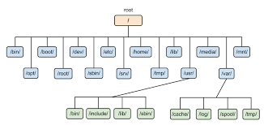

# Linux File System

## what is filesystem?

OS store and manage data on disk or partitions using a structure called **Filesystem**.

FileSystem includes, directories and it's related permissions.

linux stores data in hierarchy of directories and files.

## 

### root (/) directory

the root is the starting location of the file system. where all the other directories are present like /boot, /home, /etc, /bin, etc.

- *the / represents the root directory of linux filesystem.*

- *the ~ represents the home (/home) directory of linux filesystem.*
