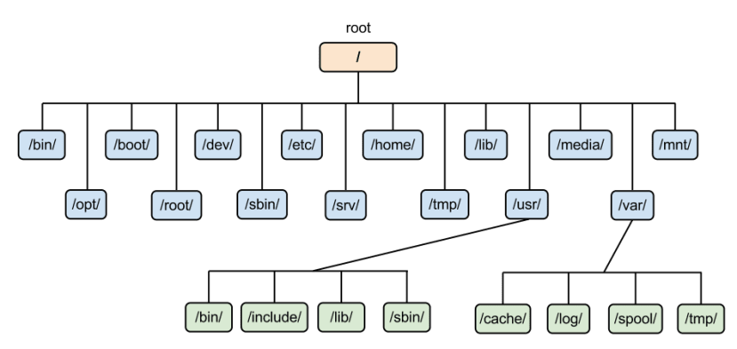

# Linux File System

## what is filesystem?

OS store and manage data on disk or partitions using a structure called **Filesystem**.

FileSystem includes, directories and it's related permissions.

linux stores data in hierarchy of directories and files.

## 

## 


### root (/) directory

the root is the starting location of the file system. where all the other directories are present like /boot, /home, /etc, /bin, etc.

- the / represents the root directory of linux filesystem. root directory also known as parent directory.

- the ~ represents the home (/home) directory of linux filesystem.

### Location/path format

- windows: C:\Program Files\Java
- Linux: /etc/folder

| linux is case sensitive.


### Types of File System

- ext3 : extended 3
- ext4 : extended 4
- XFS : extend file system [ Ubuntu, Debian, Fedora, CentOS, RedHat]
- BtrFS (B-tree Fs) : [OpenSUSE and SUSE Linux Enterprise Server]
- FAT : File Allocation Table

** How to check your Linux fileSystem?**
```bash
lsblk -f
df -Th
cat /etc/fstab
```

### XFS vs EXT4

- XFS

optimized for large files and volumes, offering superior performance and scalability.

- EXT4

Performs well across various file sizes but less efficient with extremely large files.

For High-throughput and extensive parallel processing capabilities, XFS is typically more effective then ext4.
